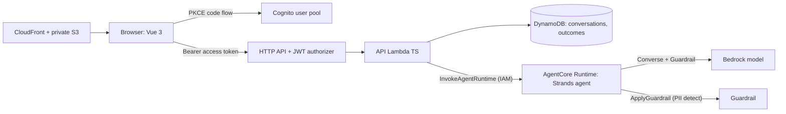

# Architecture, trust, contracts, checklist

## 1. Stack of Dreams reuse mapping (inspected, not assumed)
| Stack of Dreams (inspected) | Here |
|---|---|
| Cognito, admin-created users, public PKCE client, scopes `openid email`, `oidc-client-ts`, tokens in memory | **Reused** (same pattern, new pool in this stack) |
| API verifies Cognito *access* token (issuer, expiry, `token_use`, `client_id`); identity = `sub` only; unknown body fields rejected | **Reused**: JWT authorizer plus in-handler re-check; strict zod schemas |
| API role needs both `InvokeAgentRuntime` and `InvokeAgentRuntimeForUser` | **Reused** |
| Strands agent, AgentCore Runtime CodeZip, HTTP protocol, AWS_IAM invoke | **Reused** (defined in CDK instead of the agentcore CLI) |
| Per-request limits, validation gateway, quotas | **Not reused** (out of this increment; tracked below) |
| React 19 + Tailwind | **Diverged**: Vue 3 per the spec (approved) |
| SAM + Python Lambdas + Function URL | **Diverged**: CDK TypeScript, TS Lambda, HTTP API (approved) |
| us-east-2 only (org SCP) | **Diverged**: us-west-2 per instruction; verified reachable with profile `breaking-barriers-ny` |

## 2. Architecture

One CDK stack: KMS key, 2 DynamoDB tables (CMK), Cognito (groups `producer`, `reviewer`), HTTP API (throttled, access logs), Lambda (30-day logs), AgentCore Runtime + role, Guardrail + version, private S3 + CloudFront (OAC, security headers), error alarm. No VPC, no public data stores.

## 3. Authentication and trusted context
0. Sign-in is explicit: signed-out visitors land on a `/login` screen with a role dropdown (Producer or Reviewer) and press **Continue to sign in**; nothing redirects to Cognito automatically. The dropdown only chooses the landing page and is remembered per browser. It grants nothing: access comes from the account's Cognito group, checked on the server, and the UI shows a message if the chosen role is not on the account. Because tokens are kept in memory only, a page refresh returns to the login screen (the Cognito session makes the next sign-in instant).
1. Browser signs in via Cognito (authorization code + PKCE, public client, no secret). Access token held **in memory only**; refresh re-runs the redirect (Cognito session cookie makes it silent). Trade-off: one redirect per page load, no script-readable long-lived token.
2. API Gateway JWT authorizer checks signature, issuer, audience (`client_id`) and expiry. The Lambda re-checks `token_use=access`, client, issuer, exp; ID tokens are rejected.
3. Identity = `sub`. Role = `cognito:groups` (`producer`/`reviewer`), checked in the service for every operation. Frontend route guards are UX only.
4. `sub` -> producer profile is a server-written item (`PROFILE#`). Producer id, location, crop, entity type are **never read from the request**; strict schemas reject unknown fields.
5. The backend builds the agent's trusted context (conversation id, language, mode, profile). The agent entry point binds tools to it by closure; no tool accepts a scope argument. Location/entity corrections from the producer are validated (entity allow-list) and stored as *assertions* only; they never change lookup scope.
6. Foreign conversation ids return the same 404 as missing ones.

## 4. Conversation state, consent, retention
`workflow`: `intake -> playback_pending -> guidance_pending -> consent_pending -> closed`. Transitions are made by the application: the agent only *proposes* a playback (ignored before 2 user turns) or summary. `consent`: `unanswered|granted|declined`; `confirmation`: `none|pending|confirmed`.
- AgentCore session id = `ftusa-conv-<conversationId>`. The backend resends history each turn, so a runtime session expiry loses nothing (the session is a cache, not the source of truth). Runtime idle timeout is 15 min (verify at deploy).
- Retention (sandbox, shown in UI): active conversation messages expire 7 days after last activity (TTL; DynamoDB TTL deletion can lag up to ~48h). A **saved** conversation keeps its transcript and title for 30 days so the producer can reopen it read-only from history; a **declined** one has its transcript and title deleted when it ends and leaves the history. Closed conversation metadata (no narrative) kept 30 days. Idempotency ledger 24h. Consented summary lives in `outcomes` (PITR on) until review/deletion policy is decided [Decide].
- Decline or early end: a `declined` outcome (owner, producer ref, timestamp, reason). No narrative. Not claimed as "nothing retained": CloudWatch/Bedrock/AgentCore operational logs and metadata may exist; app logs carry ids and events, never message text. AgentCore runtime logs payloads by default (see gaps).
- Concurrency: per-conversation DynamoDB lock (120 s) -> second concurrent turn gets retryable 409 `turn_in_progress`. Retries: `requestId` ledger returns the stored response; outcome ids are deterministic per conversation (`rec-<id>` / `dec-<id>`) with conditional puts.

## 5. API (all authenticated; JSON; errors `{error:{code,message,retryable,requestId}}`, header `x-request-id`)
| Route | Role | Notes |
|---|---|---|
| `GET /me` | any | roles, trusted profile summary |
| `DELETE /conversations/{id}` | owner | removes a saved conversation from the producer's history (summary, title, transcript, snapshots); 409 if still in progress; review record unchanged |
| `GET /conversations` | producer | history: own conversations, newest first, `{conversationId,title,language,createdAt,updatedAt,status: in_progress|saved}`; declined ones are never listed |
| `POST /conversations` `{requestId,language}` | producer | starts a new conversation; the same `requestId` returns the same conversation |
| `GET /conversations/current`, `GET /conversations/{id}` | producer, owner | restore after refresh |
| `POST /conversations/{id}/messages` `{requestId,text}` | owner | 409 `playback_required` while a playback is pending |
| `POST /conversations/{id}/playback` `{requestId,decision:confirm|correct,correction?,profileCorrection?}` | owner | confirm triggers the guidance turn |
| `POST /conversations/{id}/consent` `{requestId,storeSummary}` | owner | only in `consent_pending` |
| `POST /conversations/{id}/end` `{requestId}` | owner | narrative-free declined outcome |
| `POST /transcribe` `{requestId,language,audio}` | producer | Dictation. `audio` is base64 raw 16 kHz 16-bit mono PCM, 0.3 to 60 s. Returns `{text}`. Stateless: nothing is stored and logs hold only duration and length |
| `POST /conversations/{id}/messages/{seq}/speech` | owner | read aloud: MP3 (base64) of one of the agent's replies in the conversation language; nothing stored |
| `GET /review/stats` | reviewer | counts: pending, approved, corrected, declined, PII flagged, conversations today |
| `GET /review/producers?q&review_status&outcome&pii_only` | reviewer | producers with records, pending first; `q` matches name, producer ID, record ID or tag |
| `GET /review/producers/{id}/records` | reviewer | that producer's records, newest first; declined ones carry no narrative |
| `GET /review/producers/{id}/related` | reviewer | the team synthetic dataset rows for that producer (premium projects, surveys, certification) |
| `GET /records/{id}`, `PATCH /records/{id}` `{requestId?,review_status:approved|corrected,summary_original?,summary_en?,challenge_tags?,reviewer_note?}` | reviewer | reviewed once; approve changes nothing, a correction must change something; declined: 409 `not_reviewable` |
| `GET /reviews`, `GET /reviews/{id}`, `PUT /reviews/{id}` | reviewer | legacy, kept for older clients and smoke checks |
Codes: 400 `validation_error`, 401 `unauthorized`, 403 `forbidden`/`no_profile`, 404 `not_found`, 409 `turn_in_progress|playback_required|wrong_state|conversation_closed|stale_state|already_reviewed|not_reviewable`, 502 `agent_unavailable` (retryable; state unchanged), 500 `internal_error`. Contracts: `backend/src/contracts.ts`; agent contract: `agent/app/exchange/context.py`.

## 5e. Review screen
`/review` and `/review/:producerId` (filters `q`, `status`, `outcome`, `pii` and the open record `rec` live in the URL). Top: six stat cards, "Live · updated N s ago", Refresh, and a 15 s auto-refresh that pauses while the reviewer edits. Left: producers (pending first, PII badge, pending count, entity, crop, location, record count) and **This producer's existing data** (Premium projects, Surveys, Certification) from the team synthetic dataset in `data/team-synthetic`, labeled as fictional. Right: the producer's records as tabs; the open record shows status, outcome, language, a PII panel listing entity types (nothing is redacted automatically; the reviewer decides), both summaries side by side, the 11 challenge tags (the agent proposes 1 to 3 at guidance; reviewer changes are marked against the agent's set), claims, feedback, reasoning log and a reviewer note. Approve, or Edit then Save corrections; afterwards "Reviewed by NAME at TIME". Reviewer routes check the role before validating input, so producers always get 403. Not built yet: evidence-backed claims, producer feedback, reasoning logs, peer-example consent (shown as empty states).

## 5d. Read aloud and voice mode
Each agent reply has **Copy** and **Listen** buttons. Listen calls `POST /conversations/{id}/messages/{seq}/speech`: the server reads that reply from the caller's own conversation (404 for anyone else, and for producer messages), strips markdown, and sends it to Amazon Polly (neural voices: Joanna en-US, Lupe es-US, Léa fr-FR; long text split at sentences, 2,800 characters per request). It returns base64 MP3; nothing is stored and logs hold only character and byte counts. The browser never sends text to be spoken. A **Text / Voice** switch in the conversation header (remembered per browser) makes new replies play automatically in Voice mode; playback uses the Web Audio API, unlocked by the user's tap, so the content-security policy is unchanged and iPhone autoplay rules are respected. Not built: per-message thumbs feedback, speaking Ask answers.

## 5c. Languages
English, Spanish and French, both for the interface (language menu) and for conversations (chosen at start; the agent replies in it). Summaries are stored as `summaryOriginal` (conversation language, spec `summary_original`) plus `summaryEn`; the reviewer edits both. Dictation maps `fr` to Transcribe `fr-FR` (closest available for Côte d'Ivoire French; accuracy with real speakers is unverified). Records written before this change keep `summaryEs`, which the review view reads as the original-language summary. Guardrails PII detection accuracy on French text has not been measured.

## 5a. Chat layout and history
`/chat` and `/chat/:conversationId` (the open conversation is in the URL, so a refresh returns to it; `/share` redirects). Center: the conversation; right: "Your progress" with the five stages, current stage derived from the backend workflow, completed stages linking back to the first message of that stage (each message stores its `stage`); below 1100 px the panel folds into one line under the title. History is not shown as a list in the layout: a small icon next to the **New conversation** button opens a compact dropdown (`HistoryPanel`) grouped Today / Previous 7 days / Older with title, status and date; choosing one shows its **summary first**, then *See full conversation* opens the transcript. Saved summaries have no expiry and stay until the producer deletes them (`DELETE /conversations/{id}`, which does not change the consented review record); the transcript is kept 30 days. Data comes from `GET /conversations` (DynamoDB `owner-index`, eventually consistent). Titles are proposed by the agent at playback (display text only, never scope). Producers can hold several conversations; the current-conversation pointer gives a consistent "resume" after refresh. The producer view no longer returns or shows the PII flag (spec CHAT-19). The Feedback stage is shown but not built yet.

## 5b. Voice dictation
A microphone button in the Share and Ask composers records up to 60 s in the browser (AudioWorklet, downsampled to 16 kHz PCM), posts it to `/transcribe`, and puts the returned text in the message box for the producer to read, edit and send. The Lambda streams the clip to Amazon Transcribe (`en-US` or `es-US` from the conversation language) and returns text; audio exists only in memory for the request and is never written to S3, DynamoDB or logs. The transcript then follows the normal path, including PII flagging when it is sent. A 58 s clip took about 13 s in the sandbox, under the 30 s API limit. Not built: live word-by-word streaming (needs browser-held AWS credentials), uploading recorded files (needs storage, retention and malware handling), per-user rate limits on `/transcribe`.

## 6. Guardrails and PII
Guardrail content filters apply on every model call (`BedrockModel(guardrail_id, guardrail_version, trace disabled)`). PII entities are configured with action `NONE` (detect, no mask/block) in the CDK template. The agent also calls `ApplyGuardrail` (INPUT) on each producer message and keeps only the entity **types** -> `piiFlag` on the conversation and record. **Unverified until deployed**: that detect-only PII filters are accepted by the service with `action: NONE` and that `ApplyGuardrail` returns assessments for them. If rejected, the decision is: Comprehend `DetectPiiEntities` (as the PRD recommends) or a BLOCK/ANONYMIZE guardrail (conflicts with flag-not-redact).

## 7. Implemented vs remaining
Implemented (code + local mocks + synth): sign-in/out, protected routes, session-expiry handling, server-side role checks, profile resolution, conversation create/resume/restore, multi-turn chat, playback confirm/correct, deterministic gates, separate storage consent, decline/end, minimal reviewer list/detail/approve/correct, EN/ES UI, synthetic label, idempotency + locking, evidence-unavailable tool contracts, CDK stack.
**Not verified (needs deployment):** real Cognito login, JWT authorizer behaviour, real AgentCore invocation and session behavior, Bedrock model access, Strands structured output on the live model, Spanish quality, guardrail PII detect mode, DynamoDB conditional behavior, CloudFront/CSP with Cognito.
**Remaining MVP (explicitly not done):** evidence grounding (regional context, Athena/Glue), peer examples, standards (APS/FPS) validation and per-claim citations, the 11-tag set and tagging, bilingual record quality evaluation, Comprehend/PII handling decision, evaluation harness (tag agreement >= 80%, 0 cross-producer returns, 100% cited), warehouse joins to Premium/survey/certification data, out-of-scope refusal tests with real model, per-user quotas/cost caps (Stack of Dreams has these), KMS-encrypted/limited runtime log retention, CI/one-command deploy polish, feedback capture ("was this helpful?"), accessibility audit, real FTUSA sign-off.
**Decisions open:** storage-consent timing (implemented: after guidance, plus end-anytime), model choice/access, outcome retention after review, whether to keep AgentCore runtime payload logging for PII workloads.
