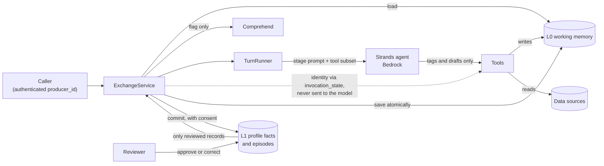

# Producer Exchange Agent: memory and chat core

A multi-turn [Strands](https://strandsagents.com) agent on Amazon Bedrock for the Fair Trade USA Producer Exchange MVP. A producer describes a challenge, the agent plays back what it understood, then drafts guidance grounded in the producer's record, regional data, peer projects and standards.

This folder covers **working memory, the producer profile and the conversation up to the draft**. It is self-contained and not wired into the deployed app yet. The rest of the repository holds that app: Vue, API Lambda, CDK and a simpler agent in `agent/`.

See it working in [`docs/smoke-test-output.md`](docs/smoke-test-output.md).

> **This repository is public.** It holds synthetic sample data only. Never commit FTUSA's shared data pack: read it through an adapter from a private path. See [Add a dataset](#add-a-dataset).

## Run it

Python 3.12+ and AWS credentials with access to Bedrock and Comprehend.

```bash
cd memory-agent
python -m venv .venv
.venv/bin/pip install -e '.[dev]'

.venv/bin/pytest                                  # offline, no AWS calls
.venv/bin/pytest -m aws                           # store contract on a temporary DynamoDB table
.venv/bin/python scripts/smoke_test.py            # live demo through Bedrock; --store dynamodb, --trace records every prompt
.venv/bin/producer-exchange --producer P-PE-008   # chat in the terminal; /memory shows working memory
```

| Variable | Default | Purpose |
|---|---|---|
| `PX_MODEL_ID` | `us.anthropic.claude-opus-5-5` | Bedrock model or inference profile |
| `PX_STORE` | `sqlite` | `sqlite` or `dynamodb` |
| `PX_SQLITE_PATH` | `.local/memory.db` | Local store location |
| `PX_DYNAMODB_TABLE` | `producer-exchange-memory` | Table with `pk`/`sk` string keys, TTL on `expires_at` |
| `PX_DATA_DIR` | `data/sample` | Sample dataset location |

To rebuild the animated replay page from a recorded trace:

```bash
python scripts/replay/build_replay.py docs/smoke-test-trace.json scripts/replay/replay_template.html replay.html
```

The replay's narration, glosses and footer are written by hand for the recording in `docs/`, so update them when you record a new one.

## How a turn works

One producer message can run several short model runs. Each run gets a prompt rebuilt from memory and only that stage's tools. When a tool changes the understanding, confirms it, finishes retrieval or stores the draft, the run ends and the next one starts from the new state. A write that only adds a quote or a note is recorded without restarting the run.



The stage is **derived from memory** by `next_phase`, so workflow state cannot disagree with the data:

| Stage | Exit condition | Tools | Memory it reads | Speaks? |
|---|---|---|---|---|
| `clarify` | All slots filled | `record_understanding` | Profile, past episodes, understanding | Yes |
| `playback` | Shown version confirmed in a later turn | `record_understanding`, `confirm_understanding` | Profile, understanding | Yes |
| `retrieve` | All four sources read | `get_producer_record`, `get_regional_context`, `search_peer_examples`, `retrieve_standards` | Profile, understanding | No |
| `draft` | Draft stored | `retrieve_standards`, `submit_guidance` | Profile, understanding, evidence | No |
| `drafted` | None yet | None | Profile, draft, evidence | Yes |

## Memory design

| | L0 working memory | L1 producer profile |
|---|---|---|
| **Holds** | A state document (stage, understanding, notes, evidence ledger, draft, PII flags) and an append-only event log (messages, tool calls with reasoning, each run's exact prompt) | Facts and episodes from past exchanges, merged over the registered record |
| **Lifetime** | One exchange, until a fixed deadline 7 days after it starts | Longitudinal, with superseded values kept |
| **Written by** | Tools, through `WorkingMemory` methods that enforce invariants | `commit_memory` and reviewers |
| **Effect** | This exchange | Other exchanges, and only after human review |
| **Code** | `memory/models.py`, `memory/working.py` | `memory/profile.py` |

The rules that matter:

- **The state is overwritten, and the log only grows.** The state is what the agent works from, and the log is the audit trail. Every event is its own document, so the state stays small. A turn saves the state and its new events in one atomic write, or nothing. `get_event_log` returns the log.
- **The model never sees raw memory.** `agent/context.py` projects only the sections a stage declares. The message history is the newest 12 text messages from the log, and tool calls and thinking are not replayed across runs. Structured memory carries what they produced, which keeps context small and makes deletion complete.
- **A detail with no slot goes in `notes`,** with the producer's exact words, so it can reach the reviewer and later exchanges. Saved quotes and notes appear in the prompt, so the model does not save them twice.
- **The profile is a read-time merge:** registered record < reviewed facts < facts confirmed in this exchange. The registered record is never modified, so a bad update can be rejected without damage.
- **Corrections keep their history.** A fact can carry `valid_from`, the start date the producer gave. When a newer reviewed value arrives for a single-valued field, the older fact stays and points at it through `superseded_by`. Rejecting the newest value restores the previous one. `get_fact_history` returns every value.
- **Conversations cannot change scope.** Location and crop facts are recorded for the reviewer, but never change what tools can read, even after approval. Add new fields to `FIELD_POLICIES`.
- **Nothing durable happens during a conversation.** `commit_memory` is the only path to L1 and takes an explicit consent decision. `discard_exchange` deletes everything held for an exchange.
- **Unreviewed records are never evidence.** One conversation cannot poison what later conversations treat as fact.
- **Every write is checked.** Quotes must be the producer's exact words, citations must resolve to this session's ledger, a confirmation must follow the playback it confirms, and saves use optimistic concurrency.

Both layers share one store interface (`memory/store.py`):

| Partition | Sort keys | Layer |
|---|---|---|
| `EXCHANGE#<id>` | `STATE`, `EVENT#00000001`, … | L0 |
| `PRODUCER#<id>` | `FACT#<id>`, `EPISODE#<id>` | L1 |

## Extend it

### Add a stage

VERIFY, PRESENT and ASK_CONSENT all follow the same three steps in `agent/phases.py`: add a `Phase`, add a branch to `next_phase`, and add a `PhaseSpec` naming its prompt, tools and memory sections.

### Add a dataset

Implement the protocols in `sources/base.py` and pass the result to `build_service(sources=...)`. Tools only see those records, and optional fields stay optional. Mapping for FTUSA's pack:

| Record | Field | FTUSA source | Note |
|---|---|---|---|
| `ProducerRecord` | `producer_id` | `account_sk` | |
| | `crops` | `product_category_name` | Split on `;` |
| | `entity_type` | `structure_txt` | Often blank; agree a mapping with FTUSA |
| | `region` | `country_region_name` | Only on project rows |
| `PremiumProject` | `reason`, `goal` | `translated_project_reason_txt`, `translated_primary_goal_txt` | No amount or outcome fields exist |
| `SurveySummary` | `metrics` | Survey CSVs | **Use an allowlist and aggregate first.** The CSVs contain sensitive columns |
| `PeerCase` | `description` | Project text | **Fictionalize first.** The text can name real organizations |
| `StandardClause` | `localized_text` | `Name_ES`, `Name_FR` in the APS workbook | Deduplicate farm-size rows and skip `_v*` variants |

### Add a storage backend

Implement `DocumentStore` (`get`, `write_all`, `delete`, `query`) and add it to the parameters in `tests/test_store_contract.py`. `write_all` must apply every write or none, and check each write's expected revision.

### Add a frontend or AgentCore entrypoint

Call `ExchangeService`. It is stateless between calls, and its responses are Pydantic models. Take `producer_id` from the authenticated session, never from the request body. A `RevisionConflict` means two turns raced, so return HTTP 409.

## Not built yet

- Verification, the PRESENT stage, feedback capture, and the consent and decline stages
- Integration with the app. `agent/` still runs its own simpler agent, and `backend/` keeps its own workflow state, consent and review records
- Real regional data and real standards. The sample's figures and clauses are placeholders
- Reopening the understanding after a draft
- State-only reads. Loading an exchange reads its whole log, so a very long exchange gets slower to load
- Summarizing older messages. They leave the prompt after the 12-message window, and only what structured memory captured remains

The draft shown to producers is labelled unverified, and `store_draft` only checks that citations resolve. Whether a claim is actually supported is the verify stage's job.
